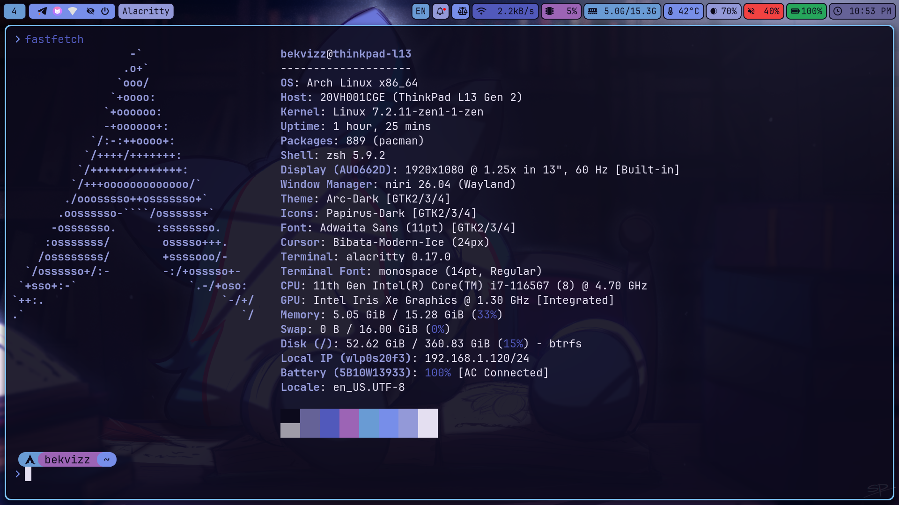

# ❄️ Arch Linux + Niri Dotfiles

A clean, dynamic scrollable-tiling Wayland setup built around **Niri** and **Pywal16**. All UI components—Waybar, Wofi, SwayNC, Alacritty, Starship, and Swaylock—automatically adapt to the active wallpaper palette.



---

## 🛠️ System Overview

| Component | Package |
| :--- | :--- |
| **OS** | Arch Linux |
| **Compositor** | [Niri](https://github.com/YaLTeR/niri) |
| **Status Bar** | `waybar` |
| **App Launcher & Menus** | `wofi` (`drun`, `run`, `cliphist`, `wofi-wifi-menu`) |
| **Notification Daemon** | `swaync` |
| **Terminal** | `alacritty` |
| **Shell & Prompt** | `zsh` + `starship` |
| **Color Engine** | `python-pywal16` (`wal`) |
| **Screen Locker** | `swaylock` (via custom Pywal wrapper script) |
| **File Manager** | `thunar` |
| **GTK / Icon / Cursor** | `Materia-dark` / `Papirus-Dark` / `Adwaita` |

---

## ✨ Features

* **Unified Pywal16 Theming:** Running `wal -i /path/to/wallpaper.png -n` dynamically recolors:
  * **Alacritty** (`~/.cache/wal/colors-alacritty.toml`)
  * **Waybar** & **Wofi** & **SwayNC** (`~/.cache/wal/colors-waybar.css`)
  * **Starship Prompt** (mapped to dynamic ANSI color slots `color4`, `color6`, `color5`)
  * **Swaylock** (via `~/.local/bin/lock.sh`)
* **Custom SwayNC Control Center:** Includes quick-toggle buttons for Wi-Fi, Bluetooth, Mute, Do Not Disturb, Power actions, and volume/backlight sliders.
* **Wayland Clipboard Management:** Integrated `cliphist` + `wofi` history viewer and deleter.
* **Dual Keyboard Layout Support:** Instant `US` / `RU` switching (`Tab`) with live status bar indicator.

---

## 📦 Installation

### 1. Clone the Repository
```bash
git clone https://github.com/USERNAME/dotfiles.git ~/dotfiles
cd ~/dotfiles
```

### 2. Install Packages
Install explicitly required official packages and AUR packages:
```bash
# Official Arch Repository packages
sudo pacman -S --needed - < pkglist.txt

# AUR packages (using yay)
yay -S --needed - < aurlist.txt
```

### 3. Copy Configurations
Back up your existing `~/.config` if needed, then copy the dotfiles over:
```bash
cp -r .config/* ~/.config/
mkdir -p ~/.local/bin ~/Pictures/wallpapers
cp -r .local/bin/* ~/.local/bin/
cp wallpapers/* ~/Pictures/wallpapers/
cp .zshrc .bash_profile .inputrc ~/
chmod +x ~/.local/bin/*.sh
```

### 4. Generate Initial Pywal Cache & Apply GTK Settings
Waybar, Wofi, and SwayNC import Pywal's CSS cache, so generate it once before launching Niri:
```bash
# Generate Pywal color cache from the included wallpaper
wal -i ~/Pictures/wallpapers/pony_wallp.png -n

# Apply Dark Mode & GTK3/GTK4 themes
gsettings set org.gnome.desktop.interface gtk-theme 'Materia-dark'
gsettings set org.gnome.desktop.interface icon-theme 'Papirus-Dark'
gsettings set org.gnome.desktop.interface cursor-theme 'Adwaita'
gsettings set org.gnome.desktop.interface cursor-size 24
gsettings set org.gnome.desktop.interface color-scheme 'prefer-dark'

# Set Zsh as default shell
chsh -s /usr/bin/zsh
```

---

## ⌨️ Keybindings

> 💡 **Quick Tip:** Press **`Mod + Shift + /`** at any time to summon Niri's built-in interactive hotkey overlay right on your screen.

### 🚀 Applications & System Utilities
| Shortcut          | Action                                     |
| :---------------- | :----------------------------------------- |
| `Mod + D`         | Open Terminal (`alacritty`)                |
| `Mod + Space`     | Application Launcher (`wofi --show drun`)  |
| `Mod + E`         | File Manager (`thunar`)                    |
| `Mod + V`         | Clipboard History (`cliphist` + `wofi`)    |
| `Mod + Shift + W` | Wi-Fi Manager (`wofi-wifi-menu`)           |
| `Mod + Shift + B` | Restart Waybar                             |
| `Mod + Shift + M` | Toggle Display Mirror (`toggle-mirror.sh`) |
| `Mod + Alt + L`   | Lock Screen (`~/.config/niri/lock.sh`)     |
| `Mod + Shift + P` | Power Off Monitors                         |
| `Mod + Shift + E` | Quit Niri Session                          |
| `Mod + Escape`    | Toggle Keyboard Shortcuts Inhibit          |

### 🪟 Window & Column Management
| Shortcut | Action |
| :--- | :--- |
| `Mod + Q` | Close Active Window |
| `Mod + O` | Toggle Workspaces Overview |
| `Mod + F` | Maximize Column |
| `Mod + Shift + F` | Fullscreen Window |
| `Mod + Ctrl + F` | Expand Column to Available Width |
| `Mod + W` | Toggle Tabbed Column Display |
| `Mod + X` | Toggle Floating / Tiling Mode |
| `Mod + Shift + X` | Switch Focus Between Floating & Tiling |
| `Mod + C` / `Mod + Ctrl + C` | Center Column / Center Visible Columns |
| `Mod + [ ` / `Mod + ]` | Consume or Expel Window Left / Right |
| `Mod + ,` / `Mod + .` | Consume / Expel Window from Column |

### 📐 Sizing & Presets
| Shortcut | Action |
| :--- | :--- |
| `Mod + R` | Cycle Preset Column Widths |
| `Mod + Shift + R` | Cycle Preset Window Heights |
| `Mod + Ctrl + R` | Reset Window Height |
| `Mod + -` / `Mod + =` | Decrease / Increase Column Width (`10%`) |
| `Mod + Shift + -` / `=` | Decrease / Increase Window Height (`10%`) |

### 🧭 Navigation, Workspaces & Monitors
| Shortcut                           | Action                                    |
| :--------------------------------- | :---------------------------------------- |
| `Mod + Arrows` / `H,J,K,L`         | Focus Column Left/Right or Window Up/Down |
| `Mod + Ctrl + Arrows` / `H,J,K,L`  | Move Column Left/Right or Window Up/Down  |
| `Mod + Home` / `End`               | Focus First / Last Column                 |
| `Mod + Ctrl + Home` / `End`        | Move Column to First / Last Position      |
| `Mod + 1..9`                       | Focus Workspace `1–9`                     |
| `Mod + Ctrl + 1..9`                | Move Column to Workspace `1–9`            |
| `Mod + U` / `I` (or `PgDn`/`PgUp`) | Focus Workspace Down / Up                 |
| `Mod + Ctrl + U` / `I`             | Move Column to Workspace Down / Up        |

---

## 📂 Repository Structure

```text
~/dotfiles
├── .config/
│   ├── alacritty/       # Terminal config with Pywal TOML import
│   ├── environment.d/   # Wayland environment variables
│   ├── gtk-3.0/         # GTK3 dark theme config
│   ├── gtk-4.0/         # GTK4 / Libadwaita dark theme config
│   ├── niri/            # Window manager config, autostart, and keybinds
│   ├── nwg-look/        # GTK settings state
│   ├── swaync/          # Notification center layout & CSS
│   ├── wal/             # Custom Pywal colorschemes
│   ├── waybar/          # Status bar modules & pill styling
│   ├── wofi/            # App launcher & Wi-Fi menu config
│   └── starship.toml    # ANSI-synced prompt configuration
├── .local/bin/
│   └── lock.sh          # Pywal-themed Swaylock script
├── wallpapers/
│   └── pony_wallp.png   # Default desktop wallpaper
├── .zshrc               # Zsh config, plugins, keybinds & Pywal sequences
├── .bash_profile        # TTY1 Niri autostart wrapper
├── .inputrc             # Case-insensitive tab completion
├── pkglist.txt          # Native Arch packages
└── aurlist.txt          # AUR packages
```